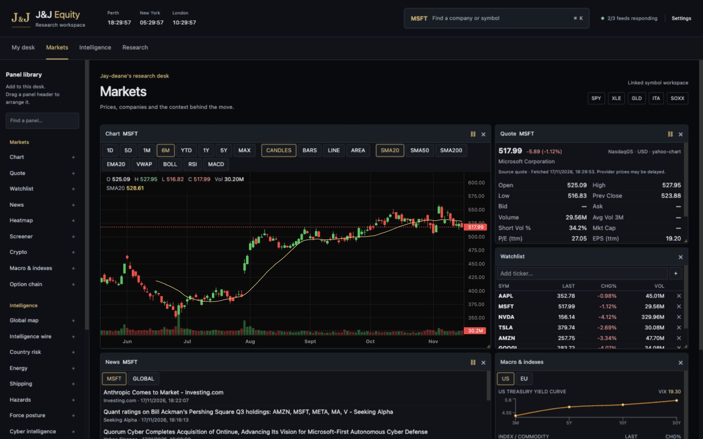

# J&J Equity

Jay-deane Huni’s personal market and intelligence research workspace. J&J Equity brings a customisable market desk, global context and a local portfolio ledger into one application.

## Your research, arranged around your work

- **My desk** keeps your own arrangement of panels, active symbol and watchlist.
- **Markets** brings charts, quotes, screening, news, options, crypto and macro context together.
- **Intelligence** connects a global map with country risk, shipping, energy, hazards, force posture and cyber panels.
- **Research** groups the portfolio ledger, research assistant, calendar, insider transactions and market recap.

Workspace exports preserve desk layouts and watchlists. Import validation rejects malformed layouts. Legacy saved workspaces are migrated into the J&J storage namespace without deleting the old copy.

The app shows provider readiness and last-observed outcomes so unavailable sources stay visible. A research assistant requires your own Anthropic key and an explicitly configured model. No paid model request is made automatically.

## Verified interface



See the [verification record and intelligence screenshots](docs/VERIFICATION.md) for the 1.3.0 checks and remaining feed limitations.

## Source layout

- `app/` — J&J application, backend, web interface, tests and desktop tooling.
- `worldmonitor/` — companion intelligence source needed for native intelligence packaging.
- `SOURCE-NOTICES.md` — third-party copyright and licence notices.
- `LICENSE` — AGPL-3.0-only licence for this integrated application.

## Run from source

Use Node.js 24 and npm. Keep the two source directories side by side.

```sh
cd app
npm ci
npm run dev
```

The market API and web app bind to local interfaces by default. See [application setup](app/README.md) for data locations, optional credentials, Docker and native packaging.

## Verify changes

```sh
cd app
npm test
npm run test:desktop
npm run typecheck
npm run build
```

The application does not connect to a brokerage or execute trades. Portfolio transactions are a local record. Market and intelligence data depend on third-party availability and may be delayed, incomplete or unavailable. Historical and reference datasets are labelled in the interface. A successful software check does not establish investment performance or predictive accuracy.

## Desktop distribution

The Apple Silicon packaging path uses pinned Electron inputs, verifies their published SHA-256 checksums, includes a J&J application icon and bundles the reviewed source archive and notices. See [build instructions](app/README.md#apple-silicon-desktop-package). Local ad-hoc signing is not Apple notarization; a notarized public distribution has not been established by this source update.
