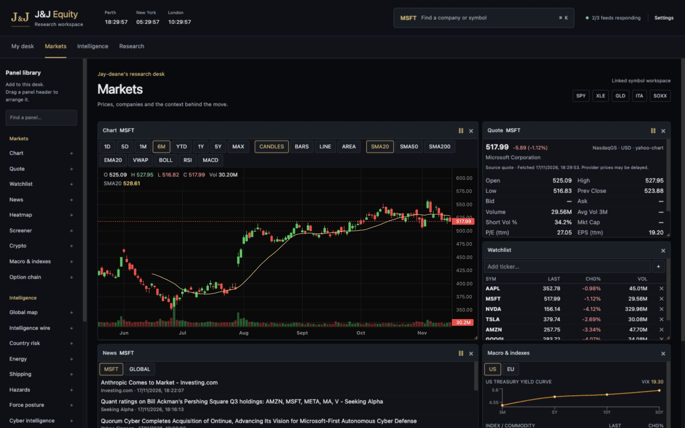
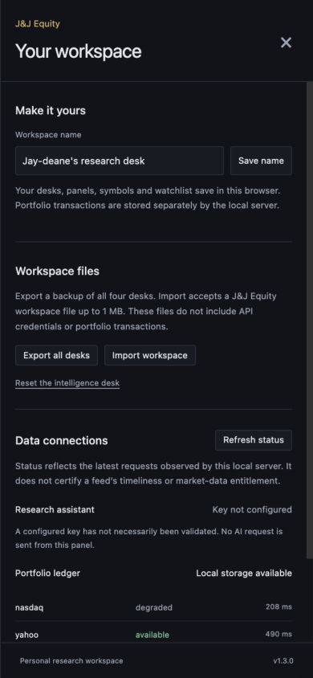

# J&J Equity 1.3.0 verification

Checked locally on an Apple Silicon Mac on 17 November 2026.

- 83 automated checks passed: 63 backend, 13 frontend logic, 7 desktop/packaging.
- Production web build and TypeScript checks passed.
- Browser: all four desks, symbol search with keyboard selection, panel add/remove, name saving, workspace export/import and invalid-file rejection.
- Synthetic portfolio ledger: recorded a buy of two shares, rejected an oversell, and confirmed the original holding after reload. Missing-quote valuations were suppressed until a usable quote arrived.
- Layouts reviewed at 1440 × 900 and 390 × 844.
- Packaged desktop: launched, loaded quotes and intelligence, and preserved workspace naming across restart using isolated test data.
- Mac application signature and installer integrity checks passed. The package is locally ad-hoc signed, not Apple-notarized.

The restart check exposed inconsistent Yahoo access from randomly chosen browser identities. The provider now uses a consistent J&J Equity application identity; the rebuilt desktop successfully fetched quotes. An empty quote response now raises a clear error instead of leaving the quote panel loading.

At final verification, Yahoo and TradingView responded in both browser and desktop. Nasdaq refused requests. Shipping timed out in an earlier run and recovered in the final browser check; its upstream dates and old-baseline warnings remained visible. These checks do not independently validate third-party data accuracy or guarantee future feed availability.

AI was intentionally unconfigured; no paid AI call was made. Docker, other operating systems and notarization were not verified. The app records local ledger transactions and does not execute brokerage trades.

## Interface evidence

